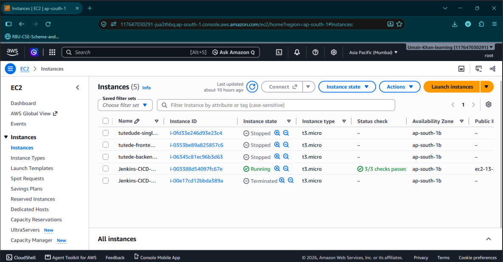
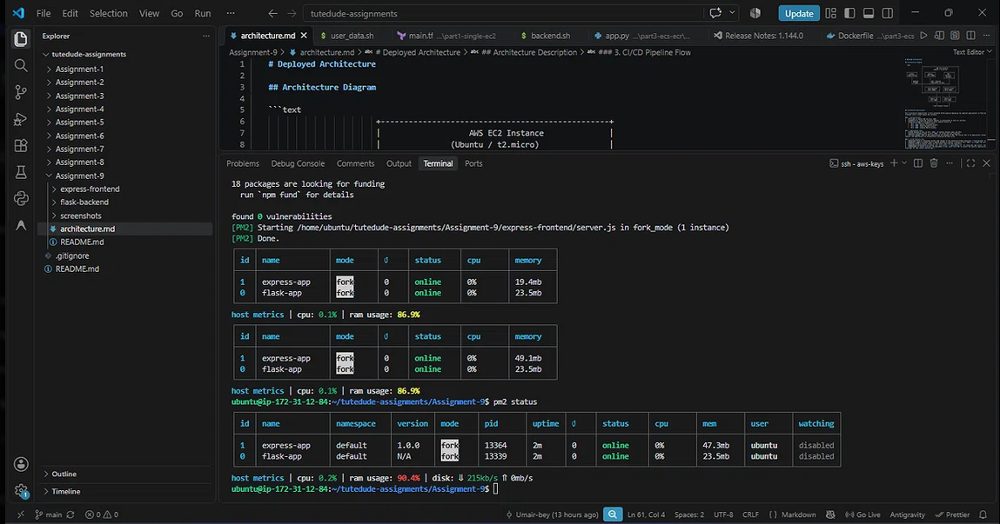
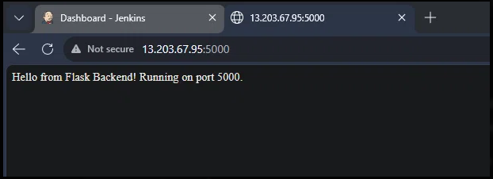
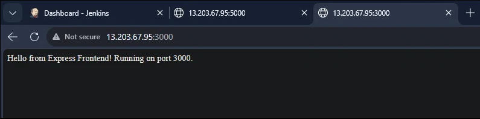
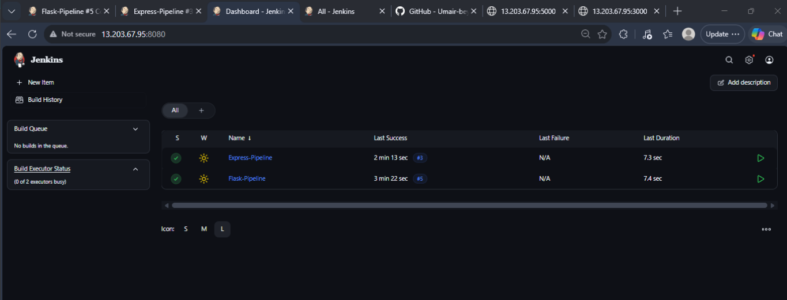
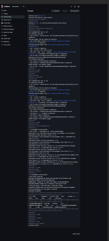
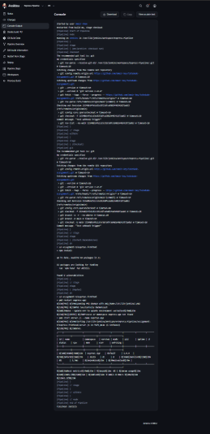

# Assignment 9: Jenkins CI/CD Pipeline

## Project Overview
This project demonstrates the deployment of a Flask backend and an Express frontend on a single AWS EC2 instance, automated via Jenkins CI/CD pipelines.

## Architecture
- **EC2 Instance:** Ubuntu 24.04 (t3.micro)
- **Flask Backend:** Running on Port 5000 (managed by PM2)
- **Express Frontend:** Running on Port 3000 (managed by PM2)
- **CI/CD Tool:** Jenkins (Running on Port 8080)

*(See `architecture.md` for the full architecture diagram)*

## Folder Structure
- `flask-backend/`: Python Flask application, requirements, and Jenkinsfile.
- `express-frontend/`: Node.js Express application, package.json, and Jenkinsfile.
- `screenshots/`: Contains proof of deployment (EC2, Jenkins, PM2, Browser).
- `architecture.md`: Explains the deployment architecture.

## GitHub Repositories
- Main Repo: [https://github.com/Umair-bey/tutedude-assignments](https://github.com/Umair-bey/tutedude-assignments)
- Flask Code: `Assignment-9/flask-backend/`
- Express Code: `Assignment-9/express-frontend/`

---

## Part 1: Manual Deployment (EC2)
1. Provisioned an AWS EC2 instance (Ubuntu 24.04, t3.micro) and configured Security Groups to allow ports 22, 3000, 5000, and 8080.
2. Installed system dependencies: Git, Python3, Node.js, PM2, Java 21, and Jenkins.
3. Cloned the GitHub repository to the EC2 instance.
4. Installed application dependencies (`pip install`, `npm install`).
5. Started both apps using PM2 to keep them running in the background.
6. Added a 1GB Swap file to the EC2 instance to prevent memory crashes.

### Screenshots
**EC2 Instance Running:**

**PM2 Status:**

**Flask Running on Port 5000:**

**Express Running on Port 3000:**

---

## Part 2: CI/CD Pipeline Setup (Jenkins)
1. Created two separate Jenkins pipelines (`Flask-Pipeline` and `Express-Pipeline`).
2. Configured both pipelines to use "Pipeline script from SCM" pointing to the respective `Jenkinsfile` in the repository subdirectories.
3. The pipelines automate:
   - Pulling the latest code from GitHub.
   - Installing dependencies.
   - Restarting the applications via PM2.
4. Configured GitHub Webhooks to trigger the Jenkins pipelines automatically on every push to the `main` branch.

### Screenshots
**Jenkins Dashboard (Both Pipelines Successful):**

**Flask Pipeline Success:**

**Express Pipeline Success:**
